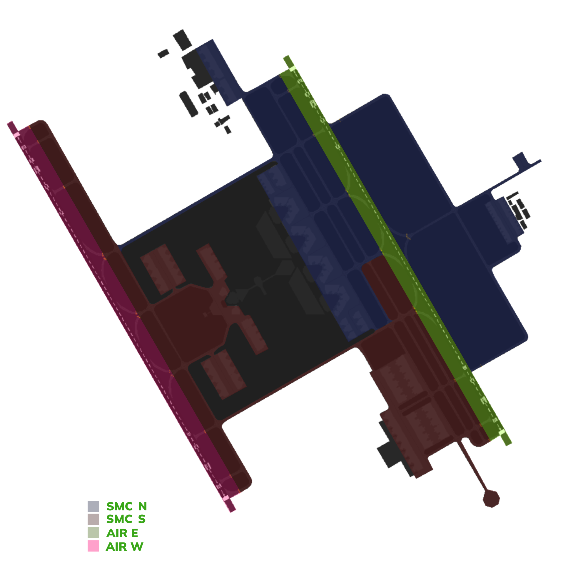

# OERK_E_TWR [AIR E] Briefing Material | Cross the Land: Westbound 2026

!!! success "Covering"
    This section details all the necessary briefing materials for **OERK_E_TWR [AIR E]** during Cross the Land: Westbound 2026

## Designated Area of Responsibility 
"*King Khalid Tower*" (OERK_E_TWR) is in charge of **runway 33R/15L, 33L/15R** operations, whether that be departures or arrivals.

---

### Notes
### 33's configuration
- Departures shall be **immediately** handed off to "*Riyadh Approach*" (OERK_E_APP) after **departure**.
- Expect departures from **Apron 1,2,3,4,5** to contact you **while taxing on G** to holding short of **V**.
- Departures from **Apron 6** will contact you **holding short of G or V** depending on where the traffic is exiting from.
- Arrival traffic shall be told the expected runway exit point. They should **vacate A4** regardless if assigned stand and be transferred to "King Khalid Ground South" **entering T** or "King Khalid Ground North" **entering P** if clear of conflict.

### 15's configuration
- Departures shall be **immediately** handed off to "*Riyadh Approach*" (OERK_E_APP) after **departure**.
- Expect departures from **Apron 1,2,3,4,5,6** to contact you **while taxing on G** to holding short of **P**.
- Arrival traffic shall be told the expected runway exit point. They should **vacate A4** regardless if assigned stand and be transferred to "King Khalid Ground South" **entering T** or "King Khalid Ground North" **entering P** if clear of conflict.