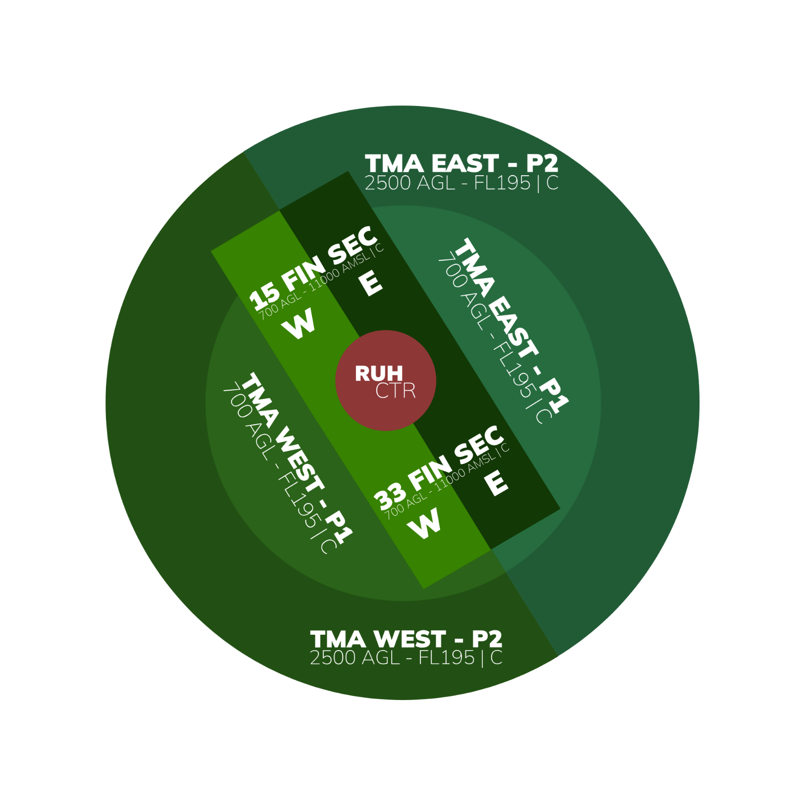

# OERK_E_APP [APP E] Briefing Material | Cross the Land: Westbound 2026

!!! success "Covering"
    This section details all the necessary briefing materials for **OERK_E_APP [APP E]** during Cross the Land: Westbound 2026

## Designated Area of Responsibility 
"*Riyadh Approach*" (OERK_E_APP) is in charge all arrivals and departures in the Riyadh TMA.

---

### Departure
- GND-FL195 = **Class C airspace**
- **RWY33R** and **RWY15L** for departures.
- No simultaneous independent departures from 33R/15L and 33L/15R.
- There will be departures from 33R/15L. Make sure lateral/vertical separation is met before handoff. No sequencing required. 8nm or greater should be the goal.
- Aircraft must be handed off to *Jeddah Control* (OEJN_3_CTR) at **FL190** or at their **exit point from Riyadh TMA**, whichever is earlier.