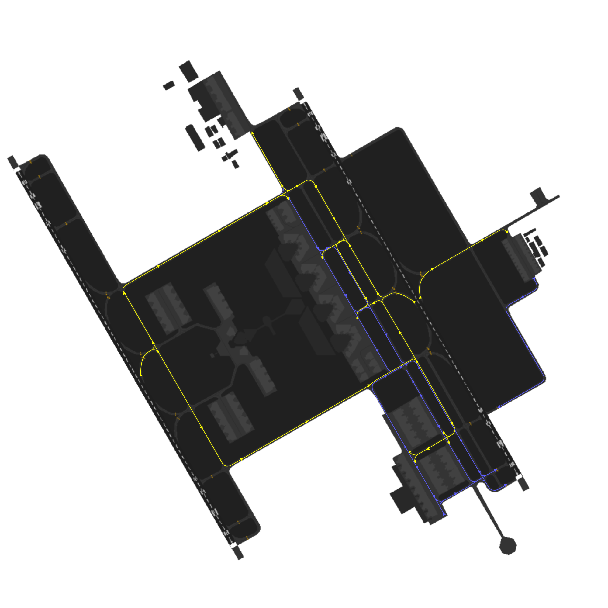
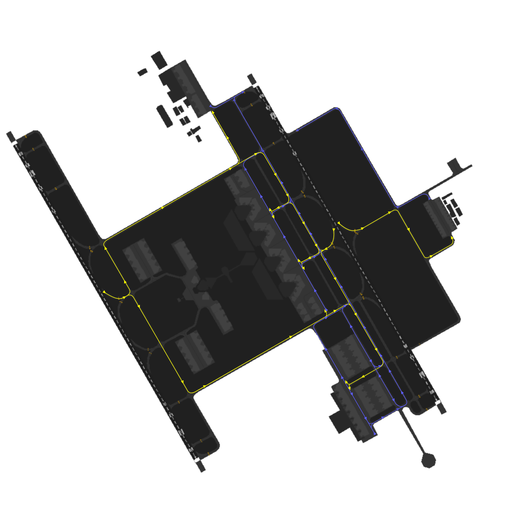

!!! success "covering" 
    This is the pilot briefing of **King Khaled International Airport**. All pilots flying out of Riyadh must familiarize themselves with this document prior to the flight.

## 1. Airport Information
### 1.1 Riyadh King Khaled International Airport (OERK)
#### 1.1.1 Airport Overview
**King Khalid International Airport (OERK)** is a prominent airport serving Riyadh, the capital city of Saudi Arabia. Located approximately 35 kilometers north of Riyadh, it covers an area of around 225 square kilometers. Opened in 1983, it replaced the older Riyadh Airport and is named after King Khalid bin Abdulaziz Al Saud.

The airport is one of the busiest in the country and features a modern terminal complex with multiple passenger terminals. It serves as a vital hub for domestic and international flights, connecting Riyadh to various destinations around the world.

## Aerodrome Details

| **Airport ICAO** |             Airport Name             | Airport Coordinates  |      Airport Runways      | Airport Elevation |
| :--------------: | :----------------------------------: | :------------------: | :-----------------------: | :---------------: |
|       OERK       | King Khalid International Airport    | 24.9606°N, 46.6998°E | 15L/33R, 15R/33L          |   1,773 feet AMSL |

## Runways

**King Khalid International Airport (OERK)** has **2** runways, **33L/15R and 33R/15L**.

### Runway Characteristics

| Runway  | Dimensions (m) | True Bearing | Elevation | Slope  |
| :-----: | :------------: | :----------: | :-------: | :----: |
| **15L** |   4000 x 60    |    150.00    |   1,700   |  0.0%  |
| **33R** |   4000 x 60    |    330.00    |   1,700   |  0.0%  |
| **15R** |   3600 x 60    |    150.00    |   1,750   |  0.0%  |
| **33L** |   3600 x 60    |    330.00    |   1,750   |  0.0%  |

### Declared Distances

| **Runway** | **TORA (M)** | **TODA (M)** | **ASDA (M)** | **LDA (M)** |
| :--------: | :----------: | :----------: | :----------: | :---------: |
|  **15L**   |     4000     |     4000     |     4000     |    4000     |
|  **33R**   |     4000     |     4000     |     4000     |    4000     |
|  **15R**   |     3600     |     3600     |     3600     |    3600     |
|  **33L**   |     3600     |     3600     |     3600     |    3600     |

## Air Traffic Services

**King Khalid International Airport (OERK)** is a fully controlled airport.

### Airspaces

|         Airspace Type         |     Airspace      | Class | Vertical Limits |          Controller          |
| :---------------------------: | :---------------: | :---: | :-------------: | :--------------------------: |
|       **Control Zone**        |    Riyadh CTR     |   C   |  SFC - 4500ft   |             AIR E            |
| **Terminal Maneuvering Area** | Riyadh TMA Part 1 |   C   |  700ft - FL195  |  APP E, APP W, FIN E, FIN W  |
| **Terminal Maneuvering Area** | Riyadh TMA Part 2 |   C   | 2500ft - FL195  |  APP E, APP W, FIN E, FIN W  |
|       **Control Area**        |    Riyadh CTA     |   A   |  FL245 - FL600  |         CTR N, CTR S         |

## ATS Callsigns

|     **Radio Callsign**      | **Logon Callsign** | **Abbreviation** | **Frequency (MHz)** |
| :-------------------------: | :----------------: | :--------------: | :-----------------: |
|       **Riyadh ATIS**       |     OERK_ATIS      |       ATIS       |       127.150       |
|     **Riyadh Delivery**     |      OERK_DEL      |       GMP        |       121.700       |
|      **Riyadh Ground**      |     OERK_N_GND     |      SMC N       |       121.600       |
|      **Riyadh Ground**      |     OERK_S_GND     |      SMC S       |       121.800       |
|      **Riyadh Tower**       |     OERK_E_TWR     |      AIR E       |       118.600       |
|      **Riyadh Tower**       |     OERK_W_TWR     |      AIR W       |       118.800       |
|     **Riyadh Approach**     |     OERK_E_APP     |      APP E       |       120.000       |
|     **Riyadh Approach**     |     OERK_W_APP     |      APP W       |       128.500       |
|  **Riyadh Final Approach**  |     OERK_E_APP     |      FIN E       |       119.750       |
|  **Riyadh Final Approach**  |     OERK_W_APP     |      FIN W       |       120.450       |
| **Riyadh Terminal Control** |     OERK_N_CTR     |      CTR N       |       126.000       |
| **Riyadh Terminal Control** |     OERK_S_CTR     |      CTR S       |       124.100       |

Table 1.1.3.2 ATS Positions

## 2. Stands Allocations
### 2.1 Stands
To ensure immersive experience, pilots are recommended to spawn on the following aprons depending on their real-world airlines gate allocations.

|       **Aprons**       |                         **Airlines**                        |
|:----------------------:|:-----------------------------------------------------------:|
|         Apron 2        |     Lowcost International Flights (Flynas, Flyadeal)        |
|         Apron 3        |     Saudia Airline & Riyadh Air (International Flights)     |
|         Apron 4        |   Mixed Domestic & International (Flynas, Flyadeal, Saudi)  |
|         Apron 5        |         Domestic & Lowcost (Flynas, Flyadeal, Saudi)        |
|         Apron 6        |   International Airlines (Iraqi, Sun air, Ariana Afghan)    |
|         Apron 7 & 9    |                           Royal Aprons                      |
|         Apron C        |                           Cargo Flights                     |
|         Apron G        |                         General Aviation                    |

Table 2.1 Stands Allocations

## 3. Preflight
### 3.1 Flight Planning
Depending on the nature of the flight, pilots must fly the correct routes whether normal flight or event flight.

#### 3.1.1 Normal Route(s)
For the majority of departures from **Riyadh**, SimBrief can automatically generate ATC-compliant flight plans by selecting the **"Preferred Route"** option. These routes are maintained and revised by our Operations Department with every AIRAC release to reflect the latest Air Traffic Flow Management (ATFM) requirements across the Middle East, while also ensuring successful validation through Eurocontrol's IFPS.

Figure 3.1.1 - Simbrief Preferred Route

#### 3.1.2 Event Route(s)
During the initial phase of the flight, it is **mandatory** for pilots to prefile with the correct event route either provided by **"Suggested Event Routes"** in myVATSIM or amended by the Delivery controller. Otherwise, pilots should expect further delays.

Figure 3.1.2 - Suggested Event Routes

### 3.2 CDM Procedures
#### 3.2.1 CDM Introduction
During large events, Collaborative Decision Making (CDM) will be put in place to regulate the flow of traffic on the ground. When this system is in use, you will be able to view your TSAT at (`https://vats.im/vdgs`).

By default, the TSAT is taken from the TOBT that you submitted on the website or the EOBT you filed in the flight plan. Pilots are expected to report ready for pushback/start-up within TSAT+-2. Should you report ready earlier, you may be given an earlier slot depending on the current traffic situation.

For events with individual CTOTs, your TSAT will be generated after you receive your IFR clearance.

|               **Time**              |                                                                                                                                                                                                                                                                                                                                                                                                                                         |
|:------------------------------------|:----------------------------------------------------------------------------------------------------------------------------------------------------------------------------------------------------------------------------------------------------------------------------------------------------------------------------------------------------------------------------------------------------------------------------------------|
| EOBT (Estimated Off-Block Time)     | This is the time when you estimate to be ready for pushback during the creation of your flight plan.                                                                                                                                                                                                                                                                                                                                    |
| TOBT (Target Off-Block Time)        | This is the time that you target to offblock. Keeping your TOBT up to date will help ATC to reduce delays and ensure a smooth operation. When you set a TOBT, ATC will treat it as a confirmed time and calculate your TSAT based on it.                                                                                                                                                                                                |
| TSAT (Target Startup Approval Time) | This is the time when ATC is planning to approve your startup. Keep in mind that it is ultimately your responsibility as the pilot to request startup within the TSAT window. In an optimal situation, your TOBT and TSAT will be at the same time. However, if there are more aircraft wanting to depart than the airport can currently accommodate, startups will be delayed and your TSAT will be at a later time than your TOBT. |
| CTOT (Calculated Take-Off Time)     | This is the actual slot for you to take off from the departure airport.                                                                                                                                                                                                                                                                                                                                                                 |

Table 3.2.1 CDM Time Definitions

#### 3.2.2 CDM Procedure and Checklist

1. Submit your flight plan on VATSIM and connect on the network at least 30 minutes prior your
off-block time (or 45 minutes before your CTOT)
2. Submit your TOBT on (`https://vats.im/vdgs`)
3. Check your TSAT on (`https://vats.im/vdgs`)
4. Request clearance 25 minutes before your EOBT/TOBT
5. Be ready and request for pushback/startup at TSAT +-2 minutes

If you failed to pushback/start up within +5 minutes after TSAT

1. Inform ATC
2. Submit your new TOBT on (`https://vats.im/vdgs`)
3. Check your new TSAT on (`https://vats.im/vdgs`)
4. Be ready and request for pushback/startup at new TSAT +-2 minutes

!!! note
    Keep on refreshing the vACDM website to check for SID/RWY/TOBT changes. TSAT updates automatically and does not require you to refresh.

### 3.3 Getting your clearance

#### 3.3.1 Voice Clearance
**Voice communication** is the preferred method for obtaining departure clearance. Pilots should contact **King Khaled Delivery** approximately **10 minutes before start-up** and prepare to provide the following information:

- Aircraft Callsign
- Aircraft Type
- Parking Stand
- Requested Flight Level (RFL)
- Destination Airport
- Standard Instrument Departure (and departure speed if unable to comply with SID minimum speed restrictions)
- Departure Runway
- Current Departure ATIS Information

Departure clearances are issued in an abbreviated format and typically include only the assigned **SID**, departure **runway**, **initial climb altitude**, and **transponder (squawk) code**. Before requesting or accepting your clearance, ensure you have obtained the latest **Departure ATIS** information.

!!! Example
    > **Pilot:** _SVA1024, Stand A10L, A320, requesting IFR clearance to Dammam_

    > **Controller:** _SVA1024, Cleared Dammam as filed, ORNIP1D Departure, Runway 33R, Initial Climb 8000ft, SQWK XXXX_

    

    ----------------------------- Pilot Readbacks --------------------------------
    

    > **Controller:** _SVA1024, Readback Correct, Information A, Report ready for push and start_

#### 3.3.2 Pre-Departure Clearance (PDC)
Pilots wishing to obtain their clearance via **Hoppie datalink** should send a clearance request to `OERK`. A CPDLC logon is **not** required prior to sending the request, and no readback is required once the clearance has been received.

!!! Warning
    **Clearance Delivery** does not issue pushback or engine start approval. After receiving your departure clearance, remain on the **Clearance Delivery** frequency and do **not** transfer to **Ground** unless instructed. Once your aircraft is fully prepared for pushback—including the jetway disconnected, tug attached, and wheel chocks removed—report **fully ready** on the Clearance Delivery frequency. When appropriate, and depending on the current airport departure flow, you will be instructed to contact the relevant **Ground** frequency for pushback and start.

## 4. Ground Movement Operations
### 4.1 Pushback Procedures
Pushback and engine start approval may only be requested after **Clearance Delivery** instructs you to contact the designated **Ground** frequency. Depending on traffic conditions and apron operations, the ground controller may assign a specific pushback procedure or direction. Pilots must confirm they are able to comply with the instruction and promptly notify the controller if they are unable to do so.

Aircraft are issued pushback clearances by the SMC controlling the respective apron that the aircraft is parking at.
The pushback direction is based primarily on aircraft location, runway configuration and the apron's flow direction.

!!! danger "Pushbacks from Aprons 1,2,3,4,5"
    Pushbacks into the alley **ARE NOT** allowed in Riyadh. All pushbacks from Aprons 1,2,3,4,5 should end on **Taxiway E**.

***Phrasesolgy:*** 

> **Pilot:** _SVA1043, Stand 403, request pushback._

> **SMC:** _SVA1043, Push & Start Approved, Face South on E._

### 4.2 Taxi Procedures
Controller may assign different taxi routes or holding points depending on traffic and aircraft characteristics. Pilots are expected to follow all assigned taxi instructions without deviation.

!!! Example
    > **Controller**: _SVA1024, Taxi via E, T, G Hold short runway 33R_

#### 4.2.1 Taxi Flow
The diagrams below illustrate the standard taxi routes in use. These routes may be modified by ATC to accommodate operational reasons or traffic conditions. In all cases, pilots shall follow ATC instructions if they differ from the published taxi routing.

Table 4.2.1 Dual Arrival Runway Operations (33s DARO) Config

Table 4.2.1 15 Dual Arrival Runway Operations (15s DARO) Config

#### 4.2.2 Departure Holding points

|       **Runway**       |   **Departure point**   |
|:----------------------:|:-----------------------:|
|            33L         |        A, A1, A2        |
|            33R         |      G, G1, G2 / H1     |
|            15L         |      G, G7, G6 / H4     |
|            15R         |        A, A7, A6        |

Table 4.2.2 Departure Holding points

## 5. Departure Procedures
### 5.1 Standard Instrument Departures (SIDs)

| **Exit Points** | **LONIB** | **TORKI** | **ORNIP** | **EGPIN** | **OTALI** | **RAPMA** | **AMBAG** | **TOTEB** | **MERVI** | **UMASU** | **KUNLO** | **IVONU** |
| :-------------: | :-------: | :-------: | :-------: | :-------: | :-------: | :-------: | :-------: | :-------: | :-------: | :-------: | :-------: | :-------: |
|     **15L**     |    1E     |    1E     |    1E     |    1E     |    1E     |    1E     |    1E     |    1E     |    2E     |    1E     |    1E     |    2E     |
|     **15R**     |    1B     |    1B     |    1B     |    1B     |    2B     |    1B     |    1B     |    1B     |    2B     |    1B     |    1B     |    2B     |
|     **33L**     |    1C     |    2C     |    1C     |    1C     |    2C     |    2C     |    2C     |    1C     |    2C     |    2C     |    2C     |    2C     |
|     **33R**     |    1D     |    2D     |    1D     |    1D     |    2D     |    2D     |    2D     |    1D     |    1D     |    1D     |    1D     |    1D     |

Table 5.1 Standard Instrument Departures (SIDs)

!!! info "Omnidirectional Departures"
    Omni-Directional Departures may be used if an older AIRAC is in use and the latest SID’s are not available.

### 5.2 Runway Operations

- The preferred runway configuration is 33s when the wind is slacking (less than 6 Kt).
- Expect hand off at 800 feet and passing the threshold (end of the runway).

#### 5.2.1 Minimum Runway Occupancy Time
To maximize runway utilization at King Khaled International Airport, pilots must follow the
following procedures:

- On receipt of the line-up clearance, pilots shall taxi into position expeditiously.
- If pilots require more separation than the WTS time-based standard or extra time for any other reason, advise ATC early PRIOR to entering the runway, NOT when on the runway. When informed, ATC may be able to make changes in the departure sequence, if necessary, to minimize delays to other succeeding departures.
- Cockpit checks shall be completed prior to line-up, any checks requiring completion whilst on the runway should be kept to the minimum required. Pilots should ensure that they are able to commence the take-off roll immediately when take-off clearance is issued.
- Once ATC issues a take-off clearance, if there is any unreasonable delay in the aircraft commencing the take-off roll, ATC may cancel the take-off clearance and reposition the aircraft in the departure sequence.
- When cleared for take-off, ATC will expect and will have planned on seeing movement within 8 to 10 seconds of the take-off clearance being issued.

### 5.3 Altitude Restrictions
All altitude restrictions on the SID are mandatory and must be complied with unless otherwise instructed by ATC.

### 5.4 Speed Restrictions
- All speed restrictions on the SID are mandatory and must be complied with unless otherwise instructed by ATC. Pilots shall strictly adhere to the speed assigned by ATC and shall request ATC approval before making any changes thereto. If it is essential to make an immediate temporary change in speed, e.g. due to turbulence, ATC shall be notified as soon as possible.
- Pilots should anticipate the following standard speed restrictions. ATC will confirm speed restriction instructions.
- If speed control is considered excessive or contrary to safe aircraft operation, ATC must be informed without delay.
